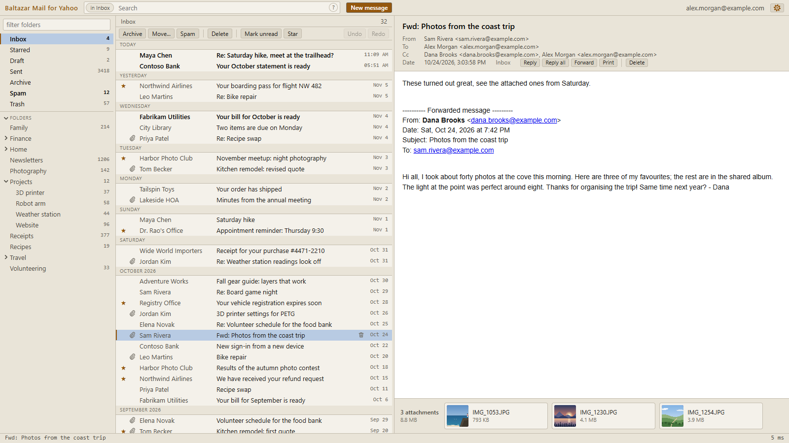
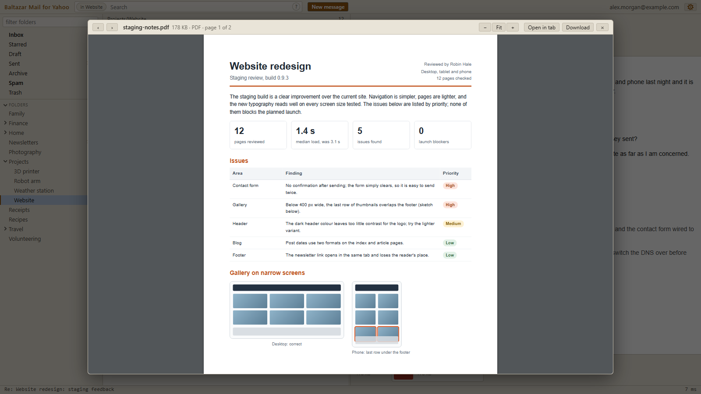
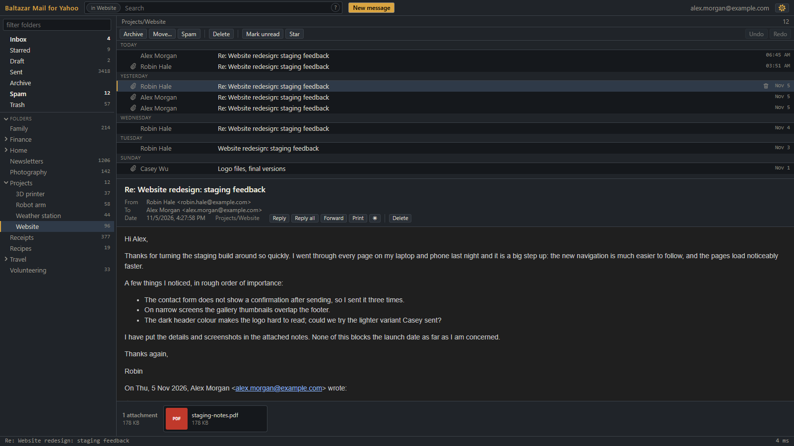
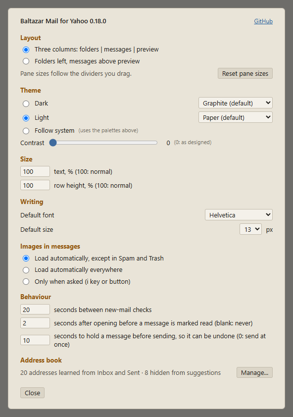

# Baltazar Mail (experimental)

A fast, ad-free mail client packaged as a Chromium (Edge/Chrome) extension, in two editions that share their code and can be installed side by side:

- **Baltazar Mail for Yahoo**, for Yahoo Mail. It reuses the Yahoo sign-in already present in the browser and talks to the same API that Yahoo's own web client uses, so it is as quick as the official UI without any of its clutter.
- **Baltazar Mail for Gmail**. It signs in with your Google account (one click, Google's own page) and talks to the Gmail API; labels appear as folders, All Mail stands in for the archive.

Everything works with the mouse; press `?` in the app for keyboard shortcuts.

Baltazar Mail is an independent project by [Baltazar Studios](https://baltazarstudios.com) and is not affiliated with Yahoo or Google. This repository is an experimental project of its own, separate from the original [Baltazar Mail](https://github.com/gdevic/baltazar-mail) for Yahoo, with its own releases.

## Features

- **Reading:** three-column or stacked layout with resizable panes, sixteen palettes, eight light and eight dark in a range of hues and mostly in light and dark pairs (two of them plain black and white), a contrast slider, one text size setting that scales the whole interface and the message, a zoom for the message pane alone, read or written, shown for a moment over the pane (+, - and 0, Ctrl+= / Ctrl+- / Ctrl+0 in the composer, or Ctrl+wheel over it), a row height setting, a Starred view across all folders but Spam and Trash, and remote images loaded automatically except in Spam and Trash. In a dark theme messages are darkened to match, keeping their colours' hues and leaving images alone; the ☀ button in the message header shows them in their original colours instead.
- **Mailbox actions:** read/unread, star, archive, move, delete, spam and not spam, on one message or a selection (click, Shift-click for a range, Ctrl-click for single rows), with multi-level undo and redo. A trash icon beside each row's date deletes it without opening it. The reader has its own Delete button, for the open message alone; for a message in Trash it reads Undelete and moves it to Inbox without asking. Right-click a message for these and for Reply, Reply all, Forward and Find all from, with each shortcut shown.
- **Folders:** right-click a folder to create a subfolder, rename, move or delete it (only when it and its subfolders are empty), or mark it all read; right-click Trash or Spam to empty it. The Folders heading above your own folders creates top-level folders and opens or closes the first level of subfolders; a double click opens or closes one folder. Subfolders of Inbox are shown under Inbox, as Yahoo files them.
- **Search:** scoped to the open folder and its subfolders, with matches in other folders (Spam and Trash aside) listed below a divider. Words must all match; `AND`, `OR`, `NOT` (or a leading `-`), parentheses, quoted phrases and the fields `from:` `to:` `subject:` `has:attachment` `is:starred` `is:read` `is:unread` `after:` `before:` refine it. The `?` in the search box explains the syntax.
- **Writing:** new message, reply, reply all and forward (with the original's attachments), drafts saved automatically, rich-text or plain-text editing with fonts, sizes and colours, pasted or dropped inline images, attachments, and undo-send.
- **Address book:** built from your own Inbox and Sent headers, with autocomplete ranked by how recently you wrote to or heard from each person. Automated senders you never wrote to (noreply, notifications, bulk-mail domains) are left out of suggestions. Settings › Address book lists it with a filter and hide/restore, also in bulk.
- **Attachments:** listed under the message and previewed in place: PDF with selectable text and zoom, Word, Excel and other spreadsheets, PowerPoint, older Word, RTF and OpenDocument text and slides through Yahoo's converter, images, text and code, CSV, HTML, audio, video and ZIP listings. Anything else up to 100 KB can be read as text, or as a hex dump when it is binary.
- **Also:** a red dot on the tab icon and toolbar button when new mail arrives while the tab is in the background, or arrived while the browser was closed and the tab opens in the background (handy for a pinned tab), contact cards (right-click a message › About sender..., or hover an address in the message header) with the person's recent messages, each opening in its folder, printing, anything that failed shown in a bar under the top bar (with details to copy for a bug report), and all settings kept between sessions.

Attachments open in place, here a two-page PDF with selectable text and zoom; photos, Office documents and spreadsheets open the same way:

The dark theme with the message list above the preview; the message is darkened to match:

Settings:

All names, addresses and messages in these screenshots are invented; `node tools/screenshots.js` regenerates them.

### Gmail: what differs

The Gmail edition has the same interface and the same features, with these differences that come from Gmail itself: Gmail's labels are the folders (a message with no label is in All Mail, and Archive moves it there); a move takes the message out of the folder it is shown in and keeps its other labels, also in Trash and Spam, and undo puts back exactly what the move changed; Spam and Trash are Gmail's; Mark all read, Empty Trash and Empty Spam work on the label; renaming a folder renames the labels nested under it. There is no document converter, so PowerPoint, Keynote, older Word, RTF and OpenDocument text and slides offer Download (and, up to 100 KB, a text or hex view) instead of a preview (PDF, Word .docx, spreadsheets of every kind, images, text and ZIP preview as before). Images in messages load straight from the senders' servers when the setting allows, since Gmail's API hands over the message as the sender wrote it (see [PRIVACY.md](PRIVACY.md)). Gmail's API has a quota per user (by default 6,000 units a minute, where a list of 100 messages costs about 500), so the extension paces its requests: the first address-book build reads the newest 2,000 messages of each of Inbox and Sent slowly in the background, in about eight minutes, leaving room for browsing. How the adapter maps Gmail onto the client is in `docs/gmail-api.md`.

## Install

Neither edition is in a browser store; both install from a release ZIP in Chrome, Edge or another browser built on Chromium, version 147 or later:

1. Download `baltazar-mail-yahoo-<version>.zip` (Yahoo) or `baltazar-mail-gmail-<version>.zip` (Gmail) from the [latest release](https://github.com/gdevic/baltazar-mail-2/releases/latest) and unzip it into a folder you will keep; it contains one folder, `baltazar-mail-yahoo` or `baltazar-mail-gmail`.
2. Open `chrome://extensions` (or `edge://extensions`) and turn on Developer mode.
3. Click Load unpacked and select that folder.
4. Yahoo: be signed in to mail.yahoo.com in the same browser profile, then click the Baltazar Mail for Yahoo toolbar icon. Gmail: click the Baltazar Mail for Gmail toolbar icon and press Sign in with Google (for now only a copy you build yourself can sign in, see below); Google asks for the account and the permission once, and the extension renews the sign-in silently afterwards, for that account only (Sign out is in Settings; it withdraws the permission and clears the address book).

A copy installed this way says in Settings when a newer release is out. To update, put the new release's files into the same folder, replacing the old ones, and click Reload on the extensions page. Windows' Extract All offers a new folder by default, so point it at the folder that contains `baltazar-mail-yahoo` (or `baltazar-mail-gmail`) and confirm replacing the files; macOS's Archive Utility never replaces files, so use `unzip -o baltazar-mail-yahoo-<version>.zip -d <that folder>` in Terminal. Loading the new release from a different folder, or removing the extension, would start over without its settings and address book. From a clone of this repository, run `node tools/build.js` and load `dist/baltazar-mail-yahoo` or `dist/baltazar-mail-gmail` the same way; after a change, build again and click Reload on the extension's card.

**Gmail and Google's sign-in.** The Gmail edition's sign-in runs through an OAuth client registered with Google. A release ZIP does not carry a client id yet, so for now only a copy you build yourself can sign in; and while Google has not verified the app, its consent screen shows an "unverified app" warning and only accounts listed as test users can sign in; `docs/google-setup.md` explains how to register a client of your own for a copy you build yourself, and what store publication needs.

**Microsoft Edge: keep the tab awake.** Baltazar Mail asks the browser not to discard its tab, which keeps Chrome's Memory Saver from unloading it. Edge also puts background tabs to sleep, pinned ones included, and a sleeping tab cannot check for new mail until you click it. To keep Baltazar Mail checking in Edge (and the new-mail dot working), add it to Edge's exception list once:

1. Open `edge://settings/system` and find **Always keep these sites active** (older versions: "Never put these sites to sleep"). Click **Add site**.
2. Enter `chrome-extension://<ID>/`, with the `chrome-` prefix and the trailing slash, where `<ID>` is your copy's 32-letter extension ID. For a release ZIP, Edge derives it from the folder you loaded, so it differs on each computer or folder (it stays the same when you unzip updates over the same folder); a copy you build with a `key` in `local.json` keeps the id that key pins. The ID is in the address bar of the Baltazar Mail tab, after `chrome-extension://`, and on `edge://extensions` with Developer mode turned on.
3. To confirm, open `edge://discards`: the Baltazar Mail tab should show that it cannot sleep.

Extensions cannot add themselves to this list.

To publish a release, set the version in `VERSION`, commit, and run the Release workflow from the Actions tab with a matching tag (for example `v0.18.0`). It runs every test suite, then builds the install ZIPs and the store ZIPs (`-store.zip`, with `manifest.json` at the top level) of both editions and creates the release. The two editions share one version number.

## How the two editions are built

`ext/` is the client both editions share, and `yahoo/` and `gmail/` each hold what makes it one of them: its `manifest.json`, its `icons/` (Yahoo's envelope sits on a dark square, Gmail's has no background, so the two tell apart when both are pinned), its `api.js` (the only module that knows a mail service's wire format) and its `rules.js` (Yahoo's request rule; an empty module for Gmail). `gmail/` also has `auth.js` for Google's sign-in and `rfc822.js` for writing messages. `node tools/build.js` copies `ext/` to `dist/baltazar-mail-yahoo/` and `dist/baltazar-mail-gmail/` and lays each edition's folder over its copy (`node tools/build.js yahoo` or `gmail` builds one). Only the manifest is written rather than copied: it gets the version from `VERSION`, and from the edition's `local.json`, when that file exists, the `key` that pins the extension id wherever the folder is and, for Gmail, the OAuth client id. The build refuses an edition file that would replace a shared one, and code in one edition that names the other's hosts. Baltazar Mail relies on an undocumented Yahoo API that can change at any time; what is known about it is in `docs/yahoo-api.md`. The Gmail edition uses the documented Gmail API; `docs/gmail-api.md` says how.

## Security and privacy

Each extension talks only to its mail service (Yahoo, or Google's Gmail API and sign-in), with two exceptions: a copy loaded with Load unpacked (a release ZIP or a clone) asks GitHub once a day whether a newer release exists (an hour later after a failed check), sending no cookies and nothing about you or your mail; and in the Gmail edition, images in messages load from their senders' servers when the setting allows (by default everywhere but Spam and Trash). They have no server, analytics or telemetry, and parse attachments in a sandbox with no access to your session. Details are in [SECURITY.md](SECURITY.md), including how to report a vulnerability, and in [PRIVACY.md](PRIVACY.md), including every host contacted, everything stored and every permission.

## License

MIT, see [LICENSE](LICENSE). The bundled third-party libraries keep their own licences (Apache-2.0 and MIT), listed in [`ext/vendor/README.md`](ext/vendor/README.md).
